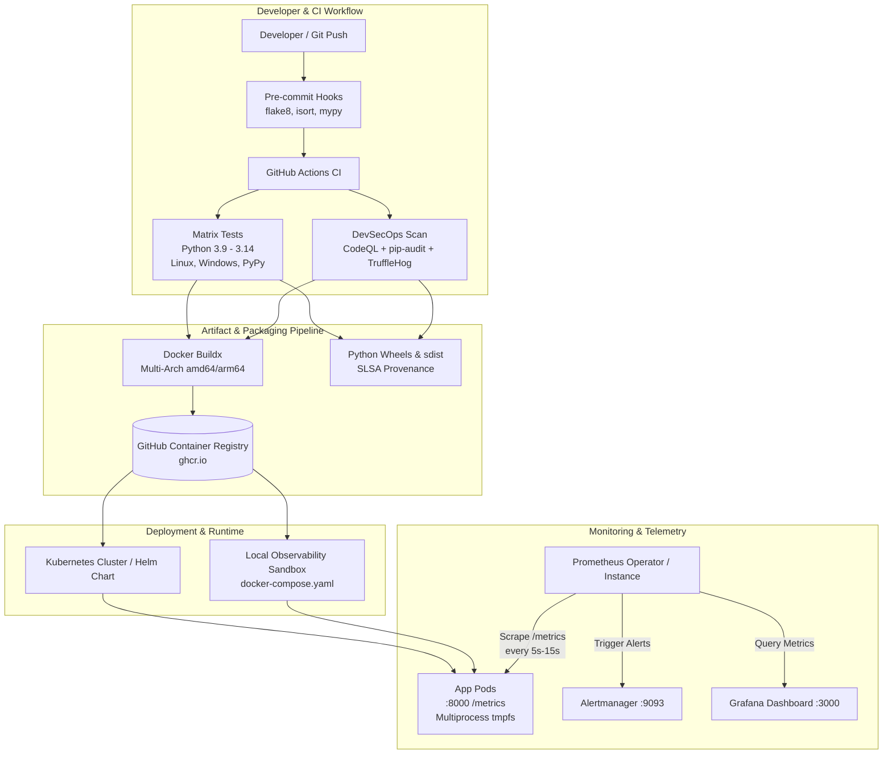

# DevOps & Observability Architecture Guide

This document outlines the DevOps architecture, CI/CD pipelines, containerization standards, deployment mechanisms, and incident response runbooks for Prometheus Python Client applications.

---

## 1. End-to-End DevOps Architecture



---

## 2. Containerization Standards

The included `Dockerfile` implements production-grade container engineering practices:

* **Multi-Stage Build**: Isolates build tools (GCC, wheel compilers) in the `builder` stage, copying only pre-compiled wheels and the clean virtual environment to the `runner` stage.
* **Minimal Base Image**: Built on `python:3.12-slim` to minimize CVE attack surface.
* **Non-Root Execution**: Runs as unprivileged user `appuser` (UID `10001`) and group `appgroup` (GID `10001`).
* **In-Container Health Check**: Implements `HEALTHCHECK` using Python's standard `urllib` library, eliminating external dependencies like `curl` or `wget`.
* **Multiprocess Memory Mount**: Pre-allocates `/tmp/metrics` with permissions configured for Gunicorn / Uvicorn worker aggregation.

---

## 3. Local Observability Sandbox Quickstart

The repository provides a complete local observability sandbox (`docker-compose.yaml`):

```bash
# Start the full observability stack
make compose-up
# or: docker compose up -d --build
```

### Sandbox Endpoints

| Service | URL | Default Credentials | Description |
| :--- | :--- | :--- | :--- |
| **Reference Microservice** | `http://localhost:8000` | N/A | Production instrumented app |
| **Metrics Endpoint** | `http://localhost:8000/metrics` | N/A | Raw Prometheus metrics exposition |
| **Prometheus Server** | `http://localhost:9090` | N/A | Metric scraping and TSDB |
| **Grafana UI** | `http://localhost:3000` | `admin` / `admin` | Auto-provisioned dashboards |
| **Alertmanager** | `http://localhost:9093` | N/A | Alert grouping and dispatching |

To shut down the sandbox and purge ephemeral volumes:
```bash
make compose-down
```

---

## 4. Kubernetes Deployment & Prometheus Operator

### Using Helm

```bash
# Lint the Helm chart
helm lint charts/prometheus-python-app

# Deploy or upgrade in the cluster
helm upgrade --install prometheus-python-app ./charts/prometheus-python-app \
  --namespace monitoring-apps \
  --create-namespace \
  --values charts/prometheus-python-app/values.yaml
```

### ServiceMonitor Integration

When the Prometheus Operator is installed, the chart automatically registers a `ServiceMonitor` CRD:

```yaml
apiVersion: monitoring.coreos.com/v1
kind: ServiceMonitor
metadata:
  name: prometheus-python-app
spec:
  endpoints:
    - port: metrics
      path: /metrics
      interval: 15s
```

### Multiprocess In-Memory Volume (tmpfs)

In multi-worker environments (Gunicorn, Uvicorn), workers write metrics to memory-mapped files. The Kubernetes deployment mounts an `emptyDir` backed by RAM (`medium: Memory`) to prevent disk I/O bottlenecks:

```yaml
volumeMounts:
  - name: multiproc-metrics
    mountPath: /tmp/metrics
volumes:
  - name: multiproc-metrics
    emptyDir:
      medium: Memory
      sizeLimit: 128Mi
```

---

## 5. Operational Runbooks for Incident Response

### Runbook: TargetDown
* **Alert**: `TargetDown`
* **Symptoms**: Prometheus cannot scrape the `/metrics` endpoint for > 1 minute.
* **Triage Steps**:
  1. Check pod status: `kubectl get pods -n monitoring-apps -l app.kubernetes.io/name=prometheus-python-app`
  2. Inspect pod logs: `kubectl logs -n monitoring-apps -l app.kubernetes.io/name=prometheus-python-app --tail=100`
  3. Verify service and endpoints: `kubectl get endpoints prometheus-python-app -n monitoring-apps`
  4. Test container probe: Check if the application process hung or crashed due to OOM (`kubectl describe pod <pod-name>`).

### Runbook: HighErrorRate
* **Alert**: `HighErrorRate`
* **Symptoms**: HTTP 5xx errors exceed 5% of total requests over 2 minutes.
* **Triage Steps**:
  1. Open the **Prometheus Python Client Operational Overview** dashboard in Grafana.
  2. Check the "HTTP Request Rate by Status Code" panel to isolate which endpoint is failing.
  3. Query exception breakdown in Prometheus:
     ```promql
     sum(rate(app_exceptions_total[5m])) by (exception_type)
     ```
  4. Check upstream dependency connectivity (e.g., database timeouts, microservice dependencies).

### Runbook: HighLatency
* **Alert**: `HighLatencyP99`
* **Symptoms**: P99 latency exceeds 500ms over 3 minutes.
* **Triage Steps**:
  1. Inspect the "Request Latency Quantiles (P50, P90, P99)" panel in Grafana.
  2. Correlate with the "Process Resident Memory" and "Garbage Collection" panels to determine if Python GC pauses or memory pressure are causing delays.
  3. Verify if pod CPU is throttled by checking Kubernetes CPU metrics:
     ```promql
     rate(container_cpu_cfs_throttled_seconds_total[5m])
     ```
  4. Increase HPA replicas or adjust container CPU limits in `values.yaml` if traffic has surged.

### Runbook: HighMemory
* **Alert**: `ProcessHighMemoryUsage`
* **Symptoms**: Python process resident memory (RSS) exceeds 500MB.
* **Triage Steps**:
  1. Check if high cardinality metric labels are being dynamically created (e.g., user IDs or arbitrary UUIDs in metric label values).
  2. Check the size of `/tmp/metrics` in the container.
  3. Ensure Gunicorn `child_exit` hook is properly cleaning up dead worker memory-mapped files:
     ```python
     def child_exit(server, worker):
         multiprocess.mark_process_dead(worker.pid)
     ```
